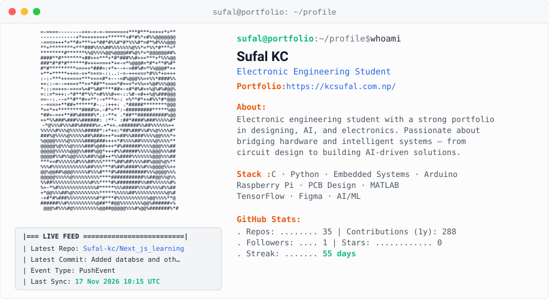

  

  <picture>
    <source media="(prefers-color-scheme: dark)" srcset="./metrics/snake-dark.svg" />
    <source media="(prefers-color-scheme: light)" srcset="./metrics/snake-light.svg" />
    
  </picture>

  

  
  &nbsp;
  

